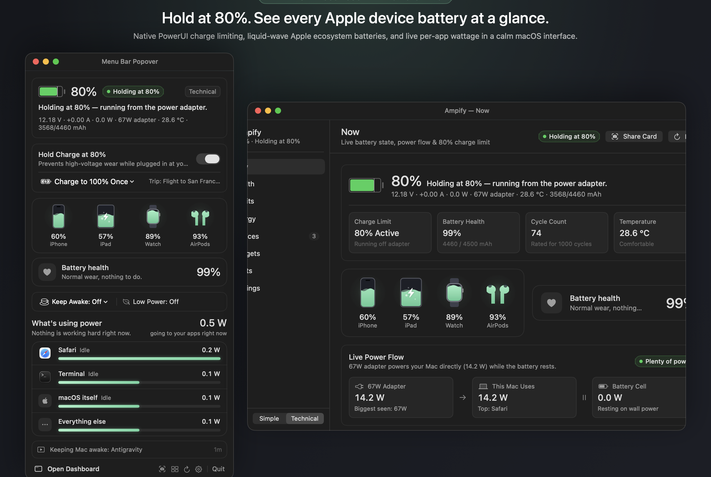
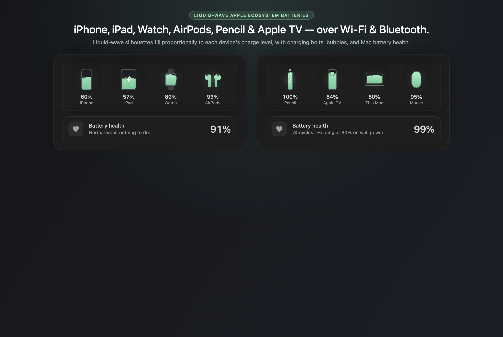
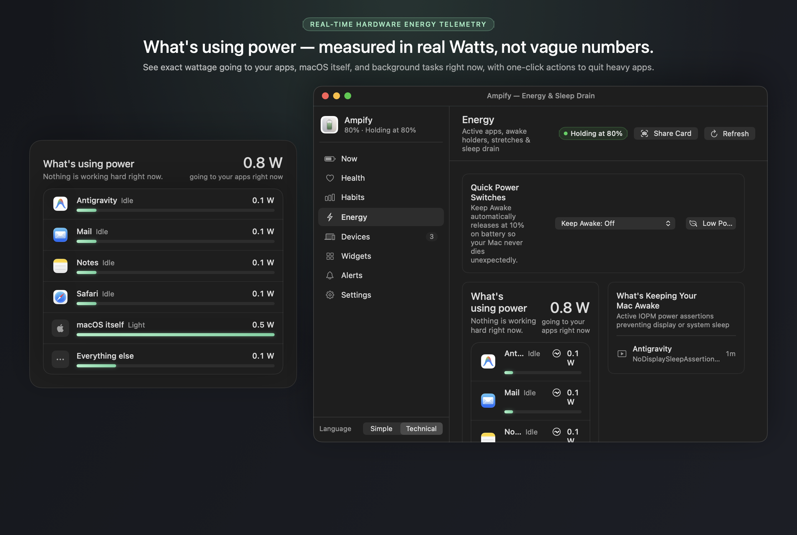
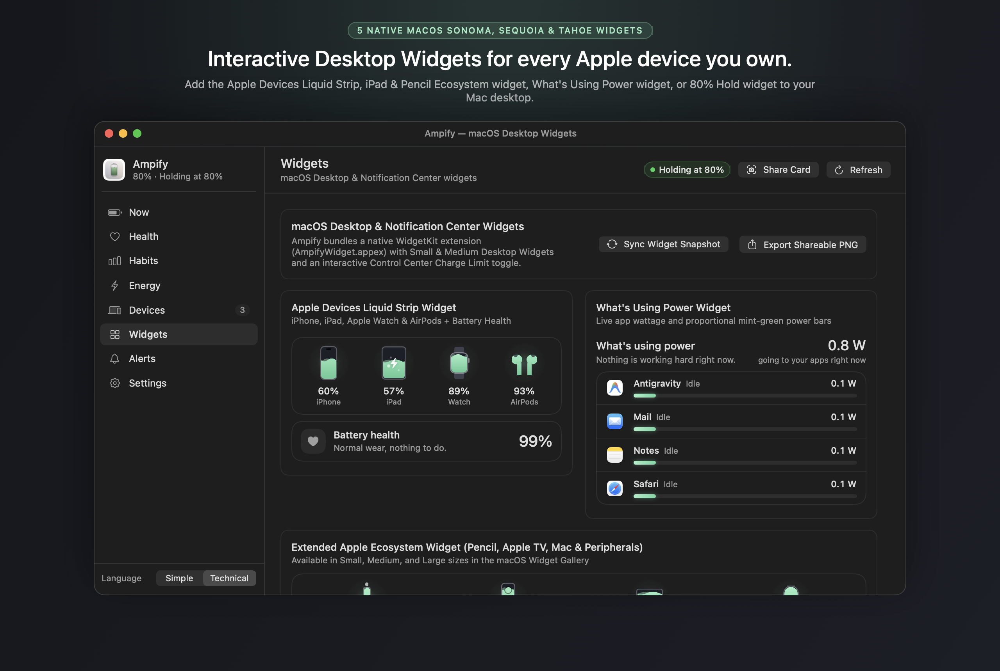
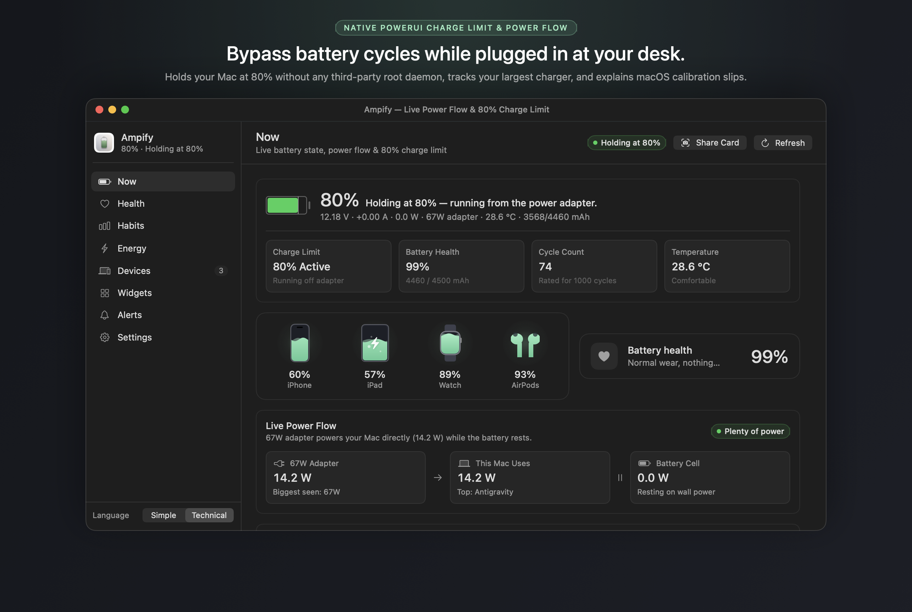
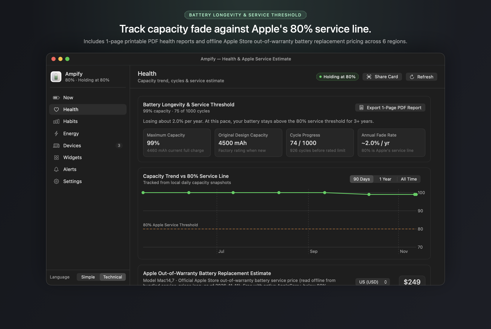
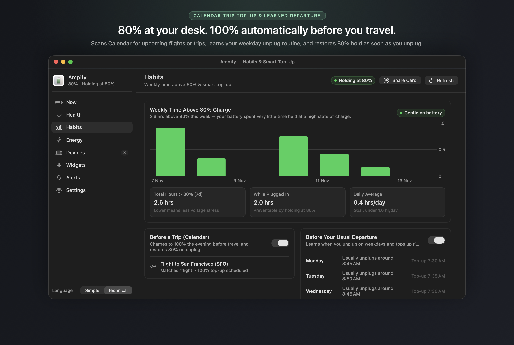
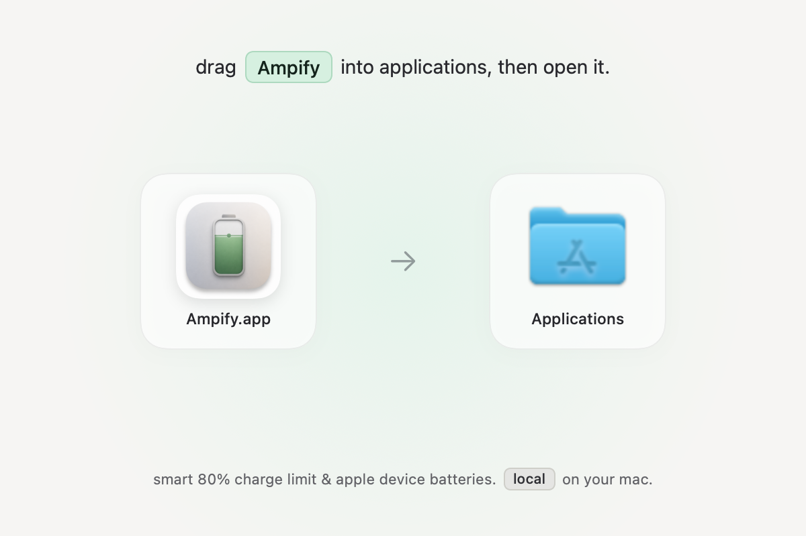

# Ampify for macOS

**Smart 80% Charge Limit, Liquid-Wave Apple Ecosystem Batteries & Live Hardware Power Telemetry — in a calm Cogify Helium System UI.**

[-38b27b?style=for-the-badge&logo=apple)](https://github.com/Shubham-sharma8/ampify/releases/download/v1.6.3/Ampify.dmg)
[](LICENSE)
[-111111?style=for-the-badge&logo=apple)](https://cogify.me/ampify)

---

## Hero Preview



---

## What is Ampify?

**Ampify** is a native Swift + Objective-C macOS menu bar app, 8-tab battery longevity dashboard, and 5-widget Desktop & Notification Center suite designed with the **Cogify Helium System UI** philosophy: calm native typography, zero neon visual clutter, and zero third-party privileged root helper daemons.

Instead of installing an invasive background root daemon that modifies SMC keys, Ampify communicates directly with macOS's native **`PowerUI.framework` (`PowerUISmartChargeClient`)**, **`IOKit` (`AppleSmartBattery`)**, **`CoreDevice` / `MobileDevice.framework`**, and **`proc_pid_rusage`** hardware energy counters.

---

## Key Features

### 1. Liquid-Wave Apple Ecosystem Battery Strip & Health Banner

- **Liquid-Wave Hardware Silhouettes**: Real-time proportional liquid-wave fills for **iPhone, iPad, Apple Watch, AirPods (Left/Right/Case), Apple Pencil Pro, Apple TV Siri Remote, MacBook, and Magic Mouse / Keyboard / Trackpad**.
- **Charging Bolts & Rising Bubbles**: Devices actively charging display a crisp lightning bolt and animated rising bubbles inside the liquid chamber.
- **Wireless CoreDevice Tunnel Discovery**: Automatically wakes the iOS 17+ / macOS wireless `CoreDevice` link to read paired iPhone, iPad, and Apple Watch (`com.apple.companion_proxy`) battery levels over Wi-Fi without plugging in a cable.

### 2. "What's Using Power" — Real Hardware Wattage Breakdown

- **Live Wattage Readout**: Shows exact Watts (`0.4 W going to your apps right now`) computed from Apple Silicon `proc_pid_rusage` (`RUSAGE_INFO_V6` `ri_energy_nj`) hardware energy counters rather than opaque activity numbers.
- **Complete System Breakdown**: Displays real running app icons, activity state (`Idle`, `Light`, `Active`, `Working hard`), proportional mint-green bars, plus **`macOS itself`** and **`Everything else`**, with one-click actions to **Quit App**, **Bring to Front**, or **Reveal in Finder**.

### 3. Five Native macOS Desktop & Notification Center Widgets

1. **Apple Devices Liquid Strip (`Medium` & `Large`)**: 4-up liquid-wave silhouettes for iPhone, iPad, Apple Watch & AirPods + Mac Battery Health banner.
2. **iPad, Pencil, Watch & Apple TV (`Small`, `Medium` & `Large`)**: Dedicated multi-device battery widget for iPad, Apple Pencil, Apple Watch, Apple TV Siri Remote, iPhone & AirPods.
3. **What's Using Power (`Medium` & `Large`)**: Live wattage and proportional power bars right on your Mac desktop.
4. **Battery & 80% Hold (`Small` & `Medium`)**: Mac battery gauge with the 80% limit line marker, health, and paired devices.
5. **Battery Health & Power (`Small` & `Medium`)**: Maximum capacity %, normal wear status, cycle count, and live wattage.

### 4. Native 80% Charge Hold & 3-Node Live Power Flow

- **Hold at 80% Without Root Daemons**: Uses `PowerUISmartChargeClient` to pause charging at 80% and run your Mac directly off the wall adapter.
- **Charge to 100% Once**: One-click temporary full charge that automatically restores your 80% limit **when unplugged**, **as soon as it reaches 100%**, or **after a set number of hours**.
- **3-Node Power Flow & Charger Memory**: Tracks watts flowing from your **Power Adapter -> This Mac -> Battery Cell** and remembers the largest adapter you usually use.

### 5. Battery Longevity & Official Apple Service Price Lookup

- **Capacity Trend vs. 80% Apple Service Line**: Tracks daily nominal mAh vs. factory design capacity and projects your annual fade rate.
- **Offline Apple Out-of-Warranty Battery Service Price**: Bundled `service-prices.json` displays official Apple Store battery replacement pricing across **US (USD), CA (CAD), UK (GBP), DE (EUR), FR (EUR), and JP (JPY)**, plus 1-page printable PDF report export.

### 6. Calendar Trip Auto-Top-Up & Learned Weekday Departure

- **Before a Trip (EventKit)**: Scans local Calendar events for travel keywords (`flight`, `airport`, `train`, `trip`, `hotel`, `conference`) and tops up to 100% the evening before.
- **Before Your Usual Departure**: Learns when you typically unplug on weekdays and tops up right before you leave.

---

## Installation

### Download Signed DMG (`v1.6.3`)
1. Download **[Ampify.dmg](https://github.com/Shubham-sharma8/ampify/releases/download/v1.6.3/Ampify.dmg)** from the [latest GitHub Release](https://github.com/Shubham-sharma8/ampify/releases/tag/v1.6.3).
2. Open `Ampify.dmg` and drag **`Ampify.app`** into **`Applications`**.
3. Launch **Ampify** from `/Applications`. To add Desktop Widgets, right-click your Mac Desktop -> **Edit Widgets…** -> search **Ampify**.



---

## Building from Source

Ampify includes both a native Xcode project (`Ampify.xcodeproj`) with the embedded `AmpifyWidgetExtension` target and a Swift Package (`Package.swift`).

```bash
# Clone the repository
git clone https://github.com/Shubham-sharma8/ampify.git
cd ampify

# Build Ampify.app + AmpifyWidgetExtension.appex with Xcode
xcodebuild -project Ampify.xcodeproj -scheme Ampify -configuration Release build

# Or build and package the signed DMG installer
./scripts/create_dmg.sh
```

---

## Brand Assets
- App Icon generated with Canva: [Open generated image](https://www.canva.com/M/MAHashmrO3Y?utm_source=OC-AZb1vOWcedZR&utm_campaign=agent_connector_create_image_asset_opened)
- Brand Logo Lockup: [View on Canva](https://canva.link/e4a6vvbiwow4s4m)

## License
Released under the [MIT License](LICENSE). Built by Shubham Sharma for [Cogify](https://cogify.me/ampify).
